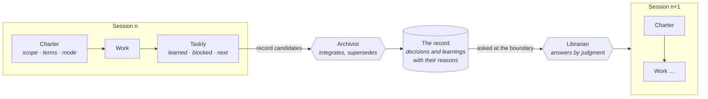

# Fabrica

**AI agents forget why.** Every session starts cold: the agent does not know what was decided last week, what already failed, or the reason behind either. So it proposes the dead end again, or quietly undoes a decision it never saw.

Fabrica is a practice that keeps those reasons in a record that the next session inherits, and brings them back at the moment they matter. This repository is the method and its plugin for Claude Code; the plugin's memory part is called ai-mem (Python package `ai_mem`, command `mem`). It is for people who run Claude Code across many sessions, or with several agents, on the same codebase.

**What it looks like.** From this repository's own record: asked *"Why doesn't the plugin inject memory before every edit?"*, the librarian answers:

> It did. Measured over 50 sessions, 348 edits injected about 67k tokens — 92% of the plugin's context footprint, whether relevant or not. Retired 2026-09-12.
> *(arch_decision_pretool_push_removed_2026_09_12)*

## The practice

Pushing memory into every prompt drowns the one decision that matters. Waiting for the agent to look things up does not work either — it does not look. Fabrica works at the boundaries of the work instead:



- **At the start** of a session, a chunk or a review, the *charter* fixes scope, terms and mode, and an agent asks the **librarian**, which decides by judgment which records apply.
- **At the end**, a short retrospective (the *Taskly*: what was learned, what blocked, what comes next) hands record candidates to the **archivist**, the one default writer.
- **The record** keeps decisions and learnings with their reasons. Outdated ones are superseded, never deleted, because the reason something was wrong is knowledge too.

The name is the *fabrica ecclesiae*, the workshop that built and kept a cathedral across generations, with a lodge book each generation handed to the next — not a factory. Fabrica has the shape of Kaizen (reflect after the work, spread a lesson sideways, replace standard work when something better is found): [the core](docs/fabrica/core.md) · [the patterns](docs/fabrica/patterns/README.md), each with its status and evidence.

## How the plugin works

The plugin remembers the way an organisation does: through rituals at boundaries, not through a smarter index.

- **Records are files.** Decisions, learnings and todos are Markdown files in the `docs/records/` of each *area* (a project or a topic). They are reviewable, greppable and versioned with the work, and you can write them by hand.
- **Two agents, one ritual.** The **librarian** is read-only and answers by judgment over the files, not by a similarity score. `/fabrica:reflect` writes the handoff and hands record candidates to the **archivist**, which integrates them: new, update, supersede, with the edges between records. Nothing is pushed into a prompt.
- **Hooks enforce that, roles decide how.** A few hooks check that the ritual happened. `mem doctor` tells you whether the practice is still alive.

Read more: [Organisational memory](docs/explanation/organisational-memory.md) · [Areas and kinds of knowledge](docs/explanation/areas-and-kinds.md) · [Glossary](docs/reference/glossary.md).

**Does it work?** Not proven. The central claim — seniority lives in the record, not in the agent — was measured once and not confirmed; other parts held. [What we measured](docs/explanation/what-we-measured.md) states what is on probation, what is a hypothesis and what failed.

**Built with itself.** This repository was built the Fabrica way. Its own record is in [`docs/records/`](docs/records/README.md): more than 250 decisions and learnings, including the dead ends, the measurements and the decisions that were later superseded.

## Install

The plugin ships two agents you talk to (`fabrica:librarian`, `fabrica:archivist`), a reviewer helper (`fabrica:anchor-lint`, checks a diff against the records it must respect), the skills (`fabrica:reflect`, `fabrica:handoff-protocol`, `fabrica:setup`), the `mem` command, `mem-dream` (an optional pass that proposes record maintenance) and four hooks. It needs Python 3.10+ as `python3` on the PATH and nothing else: no `pip install`, only the standard library.

```bash
git clone https://github.com/avataristvan/fabrica.git
claude plugin marketplace add ./fabrica
claude plugin install fabrica@fabrica
```

Restart Claude Code, then run `/fabrica:setup` to wire your own agents and CLAUDE.md. Options (`retro_roles`, `doctor_cadence_days`) are set with `/plugin configure fabrica@fabrica` and default sensibly while unset. To try it without installing: `claude --plugin-dir ./fabrica`.

## Try it

Inside Claude Code, `mem` is on the PATH. In a plain terminal, put it there first:

```bash
export PATH="$PWD/fabrica/bin:$PATH"
mkdir -p demo/docs/records && cd demo
mem add --id domain_use_postgres_2026_10_12 --type domain --topic data \
  --text "Decision: use Postgres. Why: the team knows it. Scope: the backend."
mem lint
mem doctor
```

Then open Claude Code in `demo/` and ask: *"Ask the fabrica:librarian which database we use and why."* It answers from the record and names the record it relied on.

The [tutorial](docs/tutorial/first-records.md) walks through this step by step.

## `mem doctor`

`mem doctor` is a deterministic, read-only diagnosis of whether the practice is alive: do the record files lint clean, does every current doc describe the current system, is the focus up to date, do your agents and skills actually ask the librarian, and do their `[retro]` blocks name the records they consulted. It changes nothing except a timestamp, and the SessionStart hook reminds you to run it every two weeks. Details: [architecture](docs/reference/architecture.md#doctor-ai_memdoctorpy).

## Documentation

Organised by [Diátaxis](https://diataxis.fr/).

| | |
|---|---|
| **Tutorial** | [Your first records](docs/tutorial/first-records.md) |
| **How-to** | [Set up your teams and CLAUDE.md](docs/how-to/set-up.md) · [Manage records](docs/how-to/manage-records.md) · [Wire skills and agents](docs/how-to/wire-skills-and-agents.md) · [Develop the plugin](docs/how-to/develop.md) |
| **Reference** | [Command-line reference](docs/reference/cli.md) · [Record format](docs/reference/record-format.md) · [Hooks](docs/reference/hooks.md) · [Architecture](docs/reference/architecture.md) · [Glossary](docs/reference/glossary.md) |
| **Explanation** | [Organisational memory](docs/explanation/organisational-memory.md) · [Areas and kinds of knowledge](docs/explanation/areas-and-kinds.md) · [What we measured](docs/explanation/what-we-measured.md) · [Fabrica: the core](docs/fabrica/core.md) · [Fabrica: patterns](docs/fabrica/patterns/README.md) |
| **Evidence and history** | [`docs/sources/`](docs/sources/) (dated, frozen evidence: measurements, past designs, retired systems, past handoffs) · [The removed vector-database stack](docs/reference/chroma_rollback_backend.md) · [CHANGELOG](CHANGELOG.md) |
| **For agents** | [`CLAUDE.md`](CLAUDE.md) (what is true now) · [`skills/handoff-protocol/SKILL.md`](skills/handoff-protocol/SKILL.md) (the boundary contract) · [`agents/`](agents/) · [`examples/agents/`](examples/agents/README.md) · [`reference/navigating_records.md`](reference/navigating_records.md) |

## Update and uninstall

```bash
cd fabrica && git pull                   # update the checkout
claude plugin update fabrica@fabrica     # let Claude Code pick it up
claude plugin uninstall fabrica@fabrica  # remove the plugin
```

Your record files and the runtime state in `~/.local/share/ai-mem` are never touched.

Earlier versions kept memory in a vector database behind a tool server and had an upgrade path; see the [CHANGELOG](CHANGELOG.md). The tags `v0-last-mcp` and `v1-last-upgrade-path` are the last versions with each.
