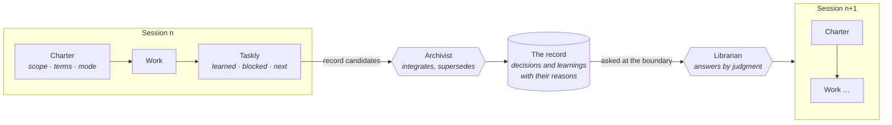

# Fabrica · ai-mem

**A practice for letting AI agents inherit experience from session to session — kept in a record, not in the agent. Whether that makes them more senior is still a hypothesis: [what we measured so far](docs/explanation/what-we-measured.md).**

Fabrica is a practice for teams of humans and agents. ai-mem is its plugin for Claude Code.
The name is the *fabrica ecclesiae*, the workshop that built and kept a cathedral across generations — not a factory ([the core](docs/fabrica/core.md)).



**The problem.** An agent starts every session cold: it does not know what was decided last week, what already failed, or why. Pushing memory into every prompt drowns the one decision that matters; waiting for the agent to look it up does not work either — it does not look.

**The idea.** A cathedral workshop kept its knowledge in a lodge book that each generation of builders handed to the next. Fabrica does the same from session to session: experience is captured at the boundaries of the work, kept with its reasons, and brought back by a librarian when a situation calls for it. If you know Lean, you know the shape — it is Kaizen for teams of humans and agents.

**An agent that knows why.** Asked *"Why doesn't ai-mem inject memory before every edit?"*, the librarian answers from the record:

> It did. Measured over 50 sessions, 348 edits injected about 67k tokens — 92% of ai-mem's context footprint, whether relevant or not. Retired 2026-09-12.
> *(arch_decision_pretool_push_removed_2026_09_12)*

**Built with itself.** This repository was built the Fabrica way. Its own lodge book is in [`docs/records/`](docs/records/INDEX.md): 237 decisions and learnings, including the dead ends, the measurements and the decisions that were later superseded. Nothing in it is proven yet; what is on probation, what is a hypothesis and what failed is stated, not hidden ([what we measured](docs/explanation/what-we-measured.md)).

## Fabrica and Kaizen

Fabrica has the shape of Kaizen, the continuous improvement of the Toyota Production System:

| Kaizen | Fabrica |
|---|---|
| Hansei: reflect after the work | Taskly: what was learned, what blocked, what next |
| Yokoten: spread a lesson sideways | the librarian brings a record to the place that needs it |
| Standard work, replaced when something better is found | decisions with their reasons, superseded, never deleted |

So in Fabrica, seniority is meant to live in the record, not in the agent. That is the claim; a first measurement did not confirm it. → [Fabrica: the core](docs/fabrica/core.md) · [the patterns](docs/fabrica/patterns/README.md), each with its status and evidence

## How ai-mem works

ai-mem remembers the way an organisation does: through rituals at boundaries, not through a smarter index. The value lies in the practice:

- **Records are files.** Decisions, learnings and todos are Markdown files in the `docs/records/` of each *area* (a project or a topic). They are reviewable, greppable and versioned with the work, and you can write them by hand.
- **Reading and writing happen at context boundaries.** At the start of a session, a chunk or a review, an agent asks the **librarian**, a read-only agent that decides by judgment which records apply. At the end, `/reflect` writes a handoff and hands what was learned to the **archivist**, the one default writer.
- **Judgment instead of scores.** Nothing is pushed into a prompt and nothing is ranked by a number. Outdated records are superseded, not deleted, because the reason something was wrong is knowledge too.
- **Hooks enforce that, roles decide how.** A few hooks check that the ritual happened. `mem doctor` tells you whether the practice is still alive.

Read more: [Organisational memory](docs/explanation/organisational-memory.md) · [Areas and kinds of knowledge](docs/explanation/areas-and-kinds.md) · [Fabrica: the core](docs/fabrica/core.md) (the method ai-mem implements).

## Install

ai-mem is a Claude Code plugin: it ships the agents (`ai-mem:librarian`, `ai-mem:archivist`, `ai-mem:anchor-lint`), the skills (`ai-mem:reflect`, `ai-mem:handoff-protocol`), the `mem` and `mem-dream` commands and the four hooks.

```bash
git clone https://github.com/avataristvan/fabrica.git
claude plugin marketplace add ./fabrica
claude plugin install ai-mem@ai-mem
```

Restart Claude Code. The plugin needs only `python3` on the PATH (no `pip install`); its options (`retro_roles`, `doctor_cadence_days`) are set with `/plugin configure ai-mem@ai-mem` and default sensibly while unset. To try it without installing: `claude --plugin-dir ./fabrica`.

Coming from an earlier version? See [Upgrading from the earlier versions](#upgrading-from-the-earlier-versions).

Requires Python 3.10+. The runtime of the practice (`mem`, hooks, lint, doctor) uses only the standard library. Works with Claude Code; the record files can be read by any tool.

## Try it

```bash
mkdir -p demo/docs/records && cd demo
mem add --id domain_use_postgres_2026_10_12 --type domain --topic data \
  --text "Decision: use Postgres. Why: the team knows it. Scope: the backend."
mem lint
mem doctor
```

The [tutorial](docs/tutorial/first-records.md) walks through this step by step.

## `mem doctor`

`mem doctor` is a deterministic, read-only diagnosis of whether the practice is alive: do the record files lint clean, does every current doc describe the current system, is the focus up to date, do your agents and skills actually ask the librarian, and do their `[retro]` blocks name the records they consulted. It changes nothing except a timestamp, and the SessionStart hook reminds you to run it every two weeks. Details: [architecture](docs/reference/architecture.md#doctor-ai_memdoctorpy).

## Documentation

Organised by [Diátaxis](https://diataxis.fr/).

| | |
|---|---|
| **Tutorial** | [Your first records](docs/tutorial/first-records.md) |
| **How-to** | [Set up your teams and CLAUDE.md](docs/how-to/set-up.md) · [Manage records](docs/how-to/manage-records.md) · [Wire skills and agents](docs/how-to/wire-skills-and-agents.md) · [Develop ai-mem](docs/how-to/develop.md) |
| **Reference** | [Command-line reference](docs/reference/cli.md) · [Record format](docs/reference/record-format.md) · [Hooks](docs/reference/hooks.md) · [Architecture](docs/reference/architecture.md) · [Glossary](docs/reference/glossary.md) · [The removed Chroma stack](docs/reference/chroma_rollback_backend.md) (historical) |
| **Explanation** | [Organisational memory](docs/explanation/organisational-memory.md) · [Areas and kinds of knowledge](docs/explanation/areas-and-kinds.md) · [What we measured](docs/explanation/what-we-measured.md) · [Fabrica: the core](docs/fabrica/core.md) · [Fabrica: patterns](docs/fabrica/patterns/README.md) |
| **Evidence and history** | [`docs/sources/`](docs/sources/) (dated, frozen evidence: measurements, past designs, retired systems) · [CHANGELOG](CHANGELOG.md) |
| **For agents** | [`CLAUDE.md`](CLAUDE.md) (what is true now) · [`skills/handoff-protocol/SKILL.md`](skills/handoff-protocol/SKILL.md) (the boundary contract) · [`agents/`](agents/) · [`examples/agents/`](examples/agents/README.md) · [`reference/navigating_records.md`](reference/navigating_records.md) |

## Upgrading from the earlier versions

Earlier versions kept memory in a vector database behind an MCP tool server and injected content into prompts. Both are replaced by record files and the roles above. The reasoning and measurements behind each retirement are kept as sources in [`docs/sources/`](docs/sources/).

The tag `v1-last-upgrade-path` is the last version that carries the upgrade path (the records_v1 migration, the upgrade guard, `install.py --plugin-switch`, `uninstall.py`, `UPGRADING.md`). Later versions drop it: an old installation checks out that tag, upgrades, and then moves on to `main`. The last version with the MCP server is the tag `v0-last-mcp`.

## Uninstall and update

```bash
claude plugin uninstall ai-mem  # the plugin
cd fabrica && git pull          # update the checkout; the plugin picks it up after `claude plugin update ai-mem@ai-mem`
```

Your record files, the runtime state in `~/.local/share/ai-mem` and your config in `~/.config/ai-mem` are never touched.
